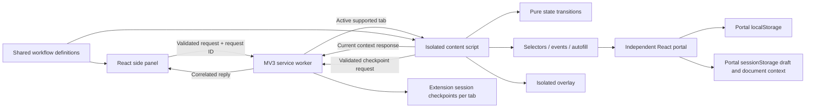

# Architecture and decisions

## State ownership

The content script owns one live workflow execution in its tab. The worker routes commands and manages minimal refresh checkpoints in `chrome.storage.session`; it is not an execution engine. The side panel displays the active tab's state. Worker suspension does not discard the live tour or its session checkpoint.

Every transition immediately sends its checkpoint request. The worker serializes operations per tab and stores a browser-provided document ID as the checkpoint writer. A refreshed document claims ownership when it reads; late writes from the previous document are rejected. Commands wait for issued saves before acknowledging progress. Checkpoints are validated against the current schema, workflow version, route, and step ID. They contain no field values, DOM snapshots, or error stacks.

After refresh, compatible in-progress guides restore paused, requiring an explicit Resume saved step. The target is checked before executing the saved step; if absent, resuming is refused without replaying previous actions. Completed guides remain completed. Cancellation/navigation clear active progress, and tab closure removes checkpoint and document ownership. Extension reload/browser restart clears extension session storage; persistent cross-session recovery is not implemented. Storage failures surface a warning while normal guidance remains usable.

The independent demo portal restores only its own per-tab workspace UI through sessionStorage: allowlisted synthetic draft fields, review stage, success notice, document query, and selected document ID. Review restoration never invokes save. Closing a form, saving, or route navigation removes the draft. This is portal functionality and does not require the extension. A real Windchill adapter must assess the host application's own draft/restoration behavior instead of assuming these demo facilities exist.

The side panel requests current context every 900ms while open. This bounded UI refresh is not DOM polling: DOM discovery is observer-driven only during an active step. A future event-driven port can replace the context refresh if measurement justifies the added reconnect protocol.

## Engine and effects

`workflow-engine.ts` is pure: given state, an event, and a definition, it returns state. An event must match the current step ID and running status; duplicate events for a previous step cannot skip ahead. The content adapter verifies target identity, native validity, event type, and user clicks before emitting completion.

The adapter owns an AbortController, a root-scoped MutationObserver, timeout, animation frame, and overlay for each step. Every transition runs cleanup before starting another step. Targets are re-resolved after portal mutations. Scroll/resize positioning is coalesced through requestAnimationFrame; a ResizeObserver covers size changes. Missing targets time out; visible targets do not impose an arbitrary deadline on users.

## DOM isolation and native dialogs

Guidance uses safe textContent and a shadow root. Normally its host is outside the portal React root. For a target inside a native modal dialog, the host is appended inside that dialog so native modal inertness does not disable its controls. A manual popover enters the browser top layer after the dialog opens. The observer does not cross the overlay's shadow root. Its full-screen host is pointer-transparent; the tooltip alone accepts pointer input. Cancellation is available in the panel and through Escape. It does not capture focus automatically.

## Safe form assistance

Only fields listed in `autofill.ts` are touched. Native value setters and bubbled input/change events notify React-controlled forms. Autofill may complete verified input steps, but cannot click Review or Confirm. The portal itself enforces native validation, required values, duplicate part numbers, and a review screen. Record creation happens only in its final explicit submit handler.

## Contextual information assistance

`packages/shared/information-highlights.ts` holds route-specific selectors, titles, descriptions, importance, and explanations. Portal `data-info` attributes annotate only existing displayed values; they do not change records or domain behavior. The typed `SET_INFORMATION_HIGHLIGHTS` command follows the existing panel -> worker -> content path. Context replies report enabled/supported/suspended status and actual matched element count.

The independent information controller owns its toggle and DOM resources. It shares `resolveTargets`/`isInteractable`, `observePortal`, `createIsolatedLayer`, and viewport placement with walkthroughs. Root-scoped observation coalesces changes in animation frames and ignores extension overlay hosts; shadow contents are not observed. Reconciliation retains unchanged buttons, removes obsolete entries and their listeners, and adds newly rendered targets. Resize/scroll reposition existing overlays without continuous polling.

Information highlights are pointer-transparent except for accessible information buttons and tooltips. Tooltips render current values with textContent, support hover/focus/Escape, and stay within the viewport. No values are persisted or sent externally. Running walkthroughs and native modal dialogs suppress information visuals; the enabled flag is retained independently. Disabling removes observers, listeners, timers, resize observation, and the layer. SPA navigation reuses the per-tab flag; reload deliberately resets it off. Overview and missing-field states are explicit. No new permissions were needed.

Display branding is Windchill Extension Demo (short form Extension Demo). Internal IDs/storage keys remain compatible. Neutral SVG UI icons and build-generated PNG manifest icons replace the former letter logo without an icon dependency.

## Trade-offs

- Hash routes make navigation observable without patching host history APIs. Real Windchill may need an adapter.
- Local configuration is compiled and versioned, never executed as arbitrary code.
- CSS selectors are tried in configured order; `data-guide` is primary. A fallback belongs in the workflow's `fallbackSelectors`, scoped to the supported portal root.
- Vite builds the portal; esbuild bundles three extension entry points. No remote imports or production sourcemaps are shipped.
- No backend, auth, LLM, analytics, or workflow editor: those do not strengthen the core browser-extension demonstration.
- Vitest was upgraded after the initial dependency audit. A narrow override upgrades only typescript-estree's minimatch dependency to the patched major; lint and TypeScript checks verify the current usage. Keep the lockfile and review/remove the override when upstream incorporates the fix.

Browser API references: [Chrome sidePanel](https://developer.chrome.com/docs/extensions/reference/api/sidePanel), [Chrome match patterns](https://developer.chrome.com/docs/extensions/develop/concepts/match-patterns), [Edge sidebar](https://learn.microsoft.com/en-us/microsoft-edge/extensions/developer-guide/sidebar).
